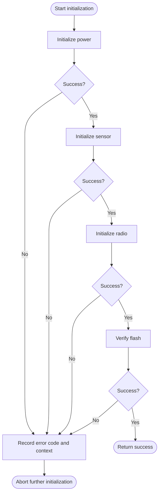
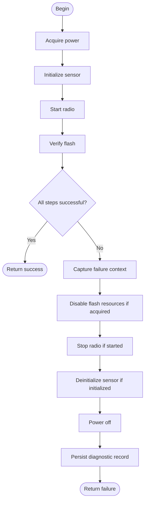
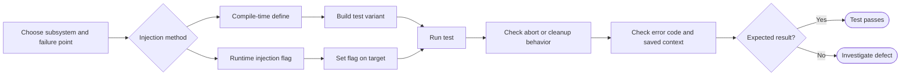
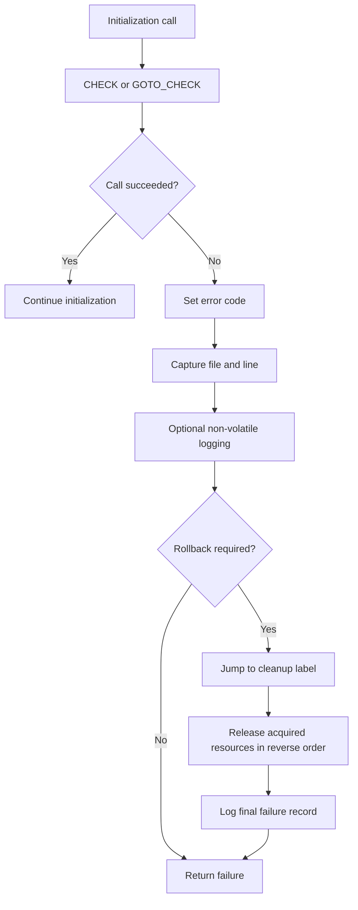

Fail-Fast Error Handling and Deterministic Fault Injection in Embedded C
A Disciplined Pattern for Safety-Critical Firmware
As firmware engineers working in high-reliability domains, we must transition our error handling from reactive debugging to proactive verification. I want to share the techniques I rely on to achieve certified code: the Fail-Fast philosophy coupled with the guaranteed resource rollback structure and deterministic fault injection.
In safety-critical and high-reliability embedded systems, such as those governed by ISO 26262 (automotive), IEC 61508 (industrial), DO-178C (avionics), or IEC 62304 (medical), the initialization of hardware and peripherals demands rigorous discipline:
Verification: Every subsystem must be verified before use.
Immediate Abort: The moment any step fails, further initialization must be aborted immediately.
Accurate Propagation: The caller must receive an accurate, specific error code that explains exactly which subsystem failed.

This discipline is known as Fail-Fast error handling and constitutes a fundamental requirement in functional-safety standards.


## The fail-fast initialization flow

This flow shows the intended control path: initialization stops at the first failure, captures diagnostic context, and either returns immediately or performs cleanup first.



## Fail-fast versus rollback cleanup

A plain `CHECK` is appropriate when no resources need to be unwound. When earlier steps have acquired resources, use a cleanup path that releases them in reverse order.



## Deterministic fault-injection test loop

Compile-time injection selects a known failure path in a test build; runtime injection selects a failure while debugging or exercising a test target.



## How the macros relate



The Fail-Fast principle states that a system should detect an error and stop normal processing immediately, rather than attempting to continue with potentially invalid or incomplete state assumptions. In initialization sequences, this is non-negotiable.
The Drawback of Verbose Error Chains
The traditional approach relies on sequential if-then-return checks.
```c
if (!init_power())   { g_last_error = ERR_POWER;  return ERR_FAILURE; }
if (!init_clock())   { g_last_error = ERR_CLOCK;  return ERR_FAILURE; }
if (!init_sensor())  { g_last_error = ERR_SENSOR; return ERR_FAILURE; }
/* ...potentially hundreds of similar lines */
```
Although functionally correct, this approach presents significant engineering and certification challenges:
Visual Noise and Code Bloat: Dozens of lines are consumed by repetitive checks, making the function hard to read and review.
Increased Defect Risk: The manual assignment of error codes (ERR_POWER, ERR_SENSOR, etc.) is highly susceptible to copy-paste errors, leading to the wrong error being reported.
Ambiguous Exit Points: Although usually structured well, highly complex functions can inadvertently lead to multiple exit paths, violating strict coding standards.

A disciplined do-while(0) macro-based approach eliminates these deficiencies while preserving and enforcing fail-fast semantics.
```c
#define CHECK(call, err_flag) do {          \
    if ((call) == 0) {                      \
        g_last_error = (err_flag);          \
        return ERR_FAILURE;                 \
    }                                       \
} while (0)
```
The resulting code is concise, visually bound (error flag sits next to its call), and structurally enforces fail-fast semantics.
```c
err_t device_init(void)
{
    CHECK(power_on(3300),           ERR_POWER);
    CHECK(sensor_init(),            ERR_SENSOR);
    CHECK(radio_begin(),            ERR_RADIO);
    CHECK(flash_verify(),           ERR_FLASH);

    return ERR_SUCCESS;   // reached only on full success
}
```
The simple macro above is excellent for early development, but certification-grade code needs more: who failed, where, why, and permanent evidence before reset. All error reporting is therefore centralized through a unified mechanism that automatically captures context and records it to non-volatile storage:
```c
// Macro to set context and return ERR_FAILURE immediately
#define RETURN_ERR_AND_CONTEXT(err_flag, inner_val) do {   \
    g_error_context.code = (err_flag);                     \
    g_error_context.inner_code = (inner_val);              \
    g_error_context.file = __FILE__;                       \
    g_error_context.line = __LINE__;                       \
    errcheck_log_to_nvram();                               \
    return ERR_FAILURE;                                    \
} while (0)
```
This ensures that every failure automatically records the exact source location (__FILE__, __LINE__) and triggers a write to NVRAM. The inner_val is particularly critical, allowing us to store the low-level hardware error code (e.g., an I2C timeout code or a specific register failure) for root cause analysis.
This helper is used by the refined production-ready CHECK macro:
```c
// 1. STANDARD CHECK: Fail-Fast (for functions NOT needing rollback)
#define CHECK(call, err_flag) do {                     \
    int __result = (call);                             \
    if (__result == 0) {                               \
        RETURN_ERR_AND_CONTEXT((err_flag), 0);         \
    }                                                  \
} while (0)
```
Every failure now generates complete, tamper-evident diagnostic records without developer intervention.
The CHECK macro guarantees no further initialization occurs, but it leaves successfully initialized peripherals active. Partial initialization states are frequently unacceptable in safety-critical applications. Resources must be released in the reverse order of acquisition.
The preferred mechanism in modern safety-oriented C coding standards (MISRA C:2012 Amendment 2, CERT C, SEI guidelines, Linux kernel) is disciplined use of goto exclusively for error handling.
```c
// GOTO CHECK: Fail-Fast with Jump (for functions REQUIRING rollback cleanup)
// On failure, sets context, DOES NOT return, and jumps to a specific cleanup label.
#define GOTO_CHECK(call, err_flag, label) do { \
    int __result = (call); \
    if (__result == 0) { \
        g_error_context.code = (err_flag); \
        g_error_context.file = __FILE__; \
        g_error_context.line = __LINE__; \
        goto label; \
    } \
} while (0)

err_t device_init_safe(void)
{
    GOTO_CHECK(power_on(3300),           ERR_POWER,    cleanup),
    GOTO_CHECK(sensor_init(),            ERR_SENSOR,   cleanup_sensor);
    GOTO_CHECK(radio_begin(),            ERR_RADIO,    cleanup_radio);
    GOTO_CHECK(flash_verify(),           ERR_FLASH,    cleanup_flash);

    return ERR_SUCCESS; // Single success path

/* Reverse-order cleanup section */
cleanup_flash:   flash_deinit();
cleanup_radio:   radio_deinit();
cleanup_sensor:  sensor_deinit();
cleanup:         power_off(3300);
                 errcheck_log_to_nvram(); // Final log when failure is confirmed
                 return ERR_FAILURE; // Single failure path
}
```
This construct delivers maximal clarity, a single point of return, automatic diagnostics, and guaranteed rollback.
What Is Fault Injection and Why Is It Essential?
Fault injection is the deliberate, deterministic simulation of a failure event at a specific point in the system's execution to verify the integrity and correctness of its corresponding error handling and recovery mechanisms.
The Imperative for Determinism
In safety-critical embedded systems, relying on real-world errors for testing is impossible because hardware faults are inherently:
Rare: They don't occur frequently enough to achieve full test coverage.
Non-deterministic: Their timing and context cannot be reliably reproduced, hindering debugging.
Difficult to Isolate: It is practically impossible to reliably trigger a specific, deep-seated failure mode (e.g., a specific bit flip in a non-volatile register) on demand.

Without controlled fault injection, engineers are forced to assume that error paths work, an assumption that is explicitly disallowed by functional-safety standards (e.g., ISO 26262 and DO-178C).
Fault Injection Requirements for Verification
Fault injection transforms error handling from an assumption into a verifiable proof. It is required to demonstrably prove the system's robustness by forcing critical safety behaviors, including:
State Machine Integrity: Proving the system transitions immediately and correctly to the designated safe state or failure state.
Temporal Reliability: Verifying that watchdog timers and internal monitoring mechanisms trigger and reset the system as expected under specific delay conditions.
Operational Resilience: Confirming that fallback and degraded modes are correctly executed, maintaining essential safety functions.
Forensic Auditing: Ensuring that error telemetry and black-box logs capture the precise error code, context, and time stamp before any system halt or reset.
Recovery Validation: Proving that recovery mechanisms function as designed to restore minimum operational capability or initiate a safe shutdown.

Fault injection moves confidence in the system's robustness from hope to evidence.
Two Complementary Injection Techniques
The same macro design supports both major injection strategies, ensuring 100% verifiable error coverage.
1. Compile-Time Fault Injection (CTI)
This method is the cornerstone of automated hardware-in-the-loop (HIL) regression suites. It forces any step to fail at compile time, resulting in zero runtime cost.
```c
#define INJECT_ERR_SENSOR
#ifdef INJECT_ERR_SENSOR
    #define CHECK_SENSOR(call) CHECK(0, ERR_SENSOR) // Force failure
    #define GOTO_RADIO(call, lbl) GOTO_CHECK(0, ERR_RADIO, lbl)
#else
    #define CHECK_SENSOR(call) CHECK(call, ERR_SENSOR) // Normal execution
    #define GOTO_RADIO(call, lbl) GOTO_CHECK(call, ERR_RADIO, lbl)
#endif
```
A single source file can be compiled N times with different injection defines, producing 100 % structural coverage of every error path with zero runtime cost.
2. Runtime Fault Injection (RTI)
This technique is indispensable for live demonstration, integration testing, and final validation on target hardware via a debugger.
When enabled (usually via #define ERRCHECK_ENABLE_RUNTIME_INJECTION), the CHECK macro is redefined to also fail if a global flag matches the current error code.
```c
volatile uint8_t g_inject_error_flag = 0;
```

Any failure can be forced from a debugger:

```text
(gdb) set var g_inject_error_flag = 3  # ERR_RADIO
(gdb) continue
```
The selected subsystem fails deterministically at the exact point of interest. In production builds, the injection code is eliminated entirely by the compiler.
Reference Implementation
A complete, extensively validated header incorporating all described techniques is available at: [error_check GitHub repository](https://github.com/subrata05/error_check)
Conclusion
The systematic application of fail-fast error handling combined with deterministic fault injection represents one of the highest-impact improvements available to embedded development teams targeting functional safety or high reliability.
This pattern eliminates repetitive boilerplate, removes an entire class of transcription errors, enforces single-point-of-return discipline, guarantees resource cleanup when required, and most critically, transforms error-path verification from speculative assumption into automated, repeatable evidence.
In domains where verifiable correctness is not optional but mandated, adoption of this disciplined approach is a practical necessity.
