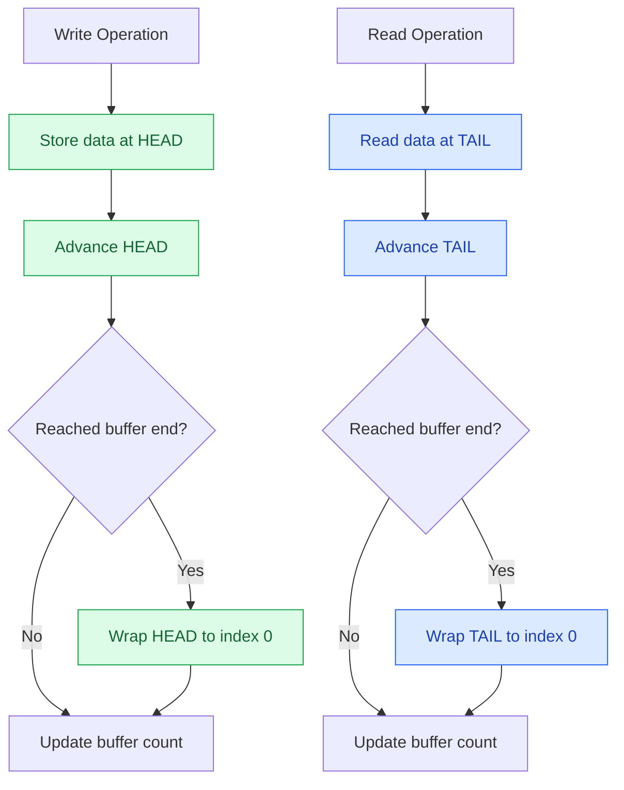
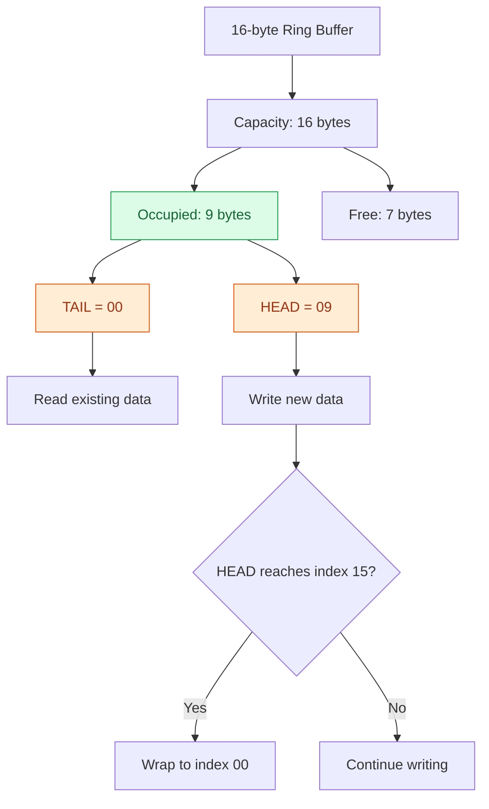
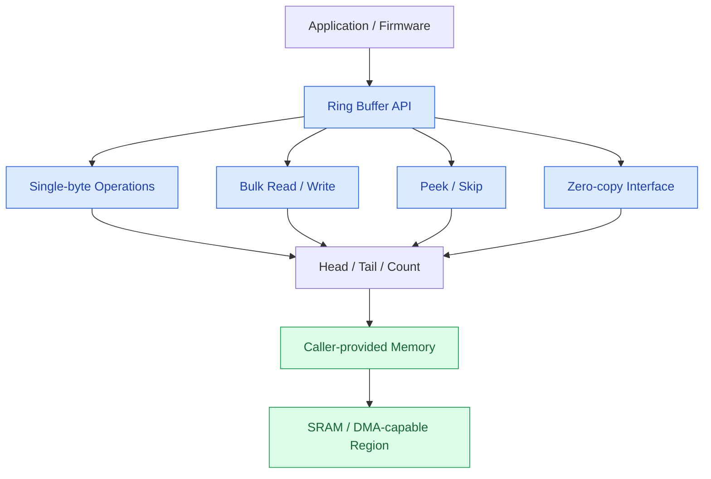
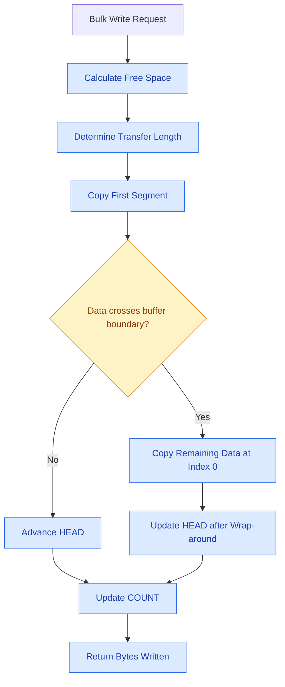
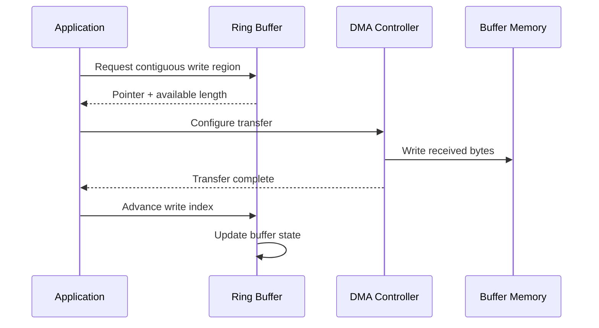

A ring buffer is a fundamental data structure in embedded systems, commonly used in UART drivers, communication stacks, DMA pipelines, and real-time applications. It provides a predictable way to handle continuous data streams without shifting existing data or repeatedly allocating memory.

I explored the design and implementation of a reusable ring buffer library in C, focusing on memory efficiency, correct wrap-around handling, and APIs suitable for embedded firmware.

## Understanding the Ring Buffer

A ring buffer uses a fixed-size memory region as a circular queue. Two indices track its state: `head` identifies the next write position, while `tail` identifies the next read position. Both wrap back to index zero when they reach the end of the buffer.

Unlike a conventional array-based queue, removing an element does not require shifting the remaining data. Reads and writes update the relevant indices, making these operations efficient and predictable.

## Buffer State and Wrap-Around

One important design consideration is distinguishing a full buffer from an empty one. When `head == tail`, the indices alone cannot tell us which state the buffer is in.

For this implementation, I use a `count` field to track the number of occupied bytes. This allows the buffer to use its entire allocated capacity without sacrificing a slot to distinguish full and empty states.

The following diagram illustrates a 16-byte buffer with nine occupied bytes. The tail points to index `00`, while the head points to index `09`. Seven bytes remain available for writing.

The buffer maintains the following invariants:

- `head` and `tail` always remain within the buffer's valid index range.
- `count` never exceeds the buffer capacity.
- A write is limited by the available free space.
- A read is limited by the number of stored bytes.
- Both indices wrap around to zero when they reach the end of the buffer.

These conditions are essential for preserving FIFO ordering and preventing out-of-bounds memory access.

## Implementation Architecture

The implementation separates the buffer's control structure from its underlying memory. Instead of allocating memory internally, the library receives a pointer to a caller-provided memory region during initialization.

This separation provides greater control over memory placement, which is particularly useful in embedded systems with constrained RAM, DMA requirements, or custom memory sections.

It also avoids internal dynamic memory allocation, making memory consumption predictable.

## Efficient Bulk Operations

Writing or reading one byte at a time is sufficient for simple applications, but bulk operations are more practical when processing communication packets or continuous data streams.

The library provides bulk read and write operations that calculate the available capacity and transfer as much data as the buffer can accommodate.

When a transfer reaches the physical end of the memory region, it is split into two segments:

1. The first segment extends from the current index to the end of the buffer.
2. The second segment begins at index zero and contains the remaining data.

Using two `memcpy()` calls avoids moving existing data and handles wrap-around without requiring a byte-by-byte copy loop. The same principle applies to bulk reads, using `tail` instead of `head`.

The functions return the number of bytes actually transferred, allowing callers to handle partial operations explicitly.

## Peek, Skip, and Zero-Copy DMA

Beyond conventional reads and writes, the library includes additional operations for applications that need more control over buffer access.

- **Peek:** Inspects buffered data without advancing the tail, useful when parsing packet headers or validating data before consuming it.
- **Skip:** Advances the tail without copying data into a destination buffer, allowing already-processed bytes to be discarded efficiently.
- **Zero-copy access:** Exposes a contiguous memory region directly to a producer or consumer, avoiding an intermediate copy.

The zero-copy interface is particularly useful for DMA-based communication.

The application requests a writable region and passes its address to the DMA controller. Once the transfer completes, the application advances the buffer's write index by the number of bytes actually received.

The returned region is contiguous only up to the end of the physical buffer. If more space is needed after reaching that boundary, the operation must be repeated for the next segment.

Correct synchronization between DMA completion, buffer index updates, and consumers is essential to prevent data corruption.

## Testing and Validation

A reusable data structure should be tested beyond its normal operating path. The test suite covers initialization, FIFO ordering, capacity limits, wrap-around, and edge cases.

The main test scenarios include:

- Initialization and buffer state checks.
- Single-byte reads and writes.
- Overflow and underflow handling.
- Bulk transfers and partial operations.
- Wrap-around while preserving FIFO ordering.
- Peek and skip behavior.
- Zero-copy pointer acquisition and index advancement.
- Invalid pointers, zero-size initialization, and oversized requests.

The wrap-around test is especially important: after reading some data from a buffer, new data is written across the end boundary. Reading the remaining contents then verifies that the original FIFO order has been preserved.

The project uses a Makefile to build the library, examples, and tests. Compiler flags such as `-Wall`, `-Wextra`, and `-Werror` help catch potential issues early and keep the codebase clean.

## Concurrency Considerations

A ring buffer is not automatically thread-safe or interrupt-safe. If an interrupt service routine (ISR) writes to the buffer while the main loop reads from it, shared state such as `head`, `tail`, and `count` must be protected from conflicting updates.

The synchronization strategy depends on the target platform and usage model. Options include protecting critical sections, using an appropriate single-producer/single-consumer design, or employing mutexes or atomic operations in a suitable operating-system environment.

The key is to define the ownership of each index and ensure that state updates remain consistent under concurrent access.

## Key Takeaways

This project explores how a simple data structure can be turned into a practical embedded C component. The implementation combines predictable memory usage with bulk transfers, non-destructive inspection, efficient skipping, and a zero-copy interface for DMA-oriented workflows.

The most important lessons are to make full and empty states unambiguous, handle wrap-around explicitly, test boundary conditions, and treat concurrency as a separate design concern.

**Source code:** [Ring Buffer Library on GitHub](https://github.com/subrata05/ring-buffer)

## References

- [GNU Make documentation](https://www.gnu.org/software/make/manual/)
- [Linux kernel `kfifo` source](https://github.com/torvalds/linux/blob/master/include/linux/kfifo.h)
- [Linux kernel FIFO API documentation](https://www.kernel.org/doc/htmldocs/kernel-api/kfifo.html)
- [Linux kernel lockless ring buffer design](https://docs.kernel.org/trace/ring-buffer-design.html)
- [FreeRTOS stream buffers](https://www.freertos.org/RTOS-stream-buffer-example.html)
